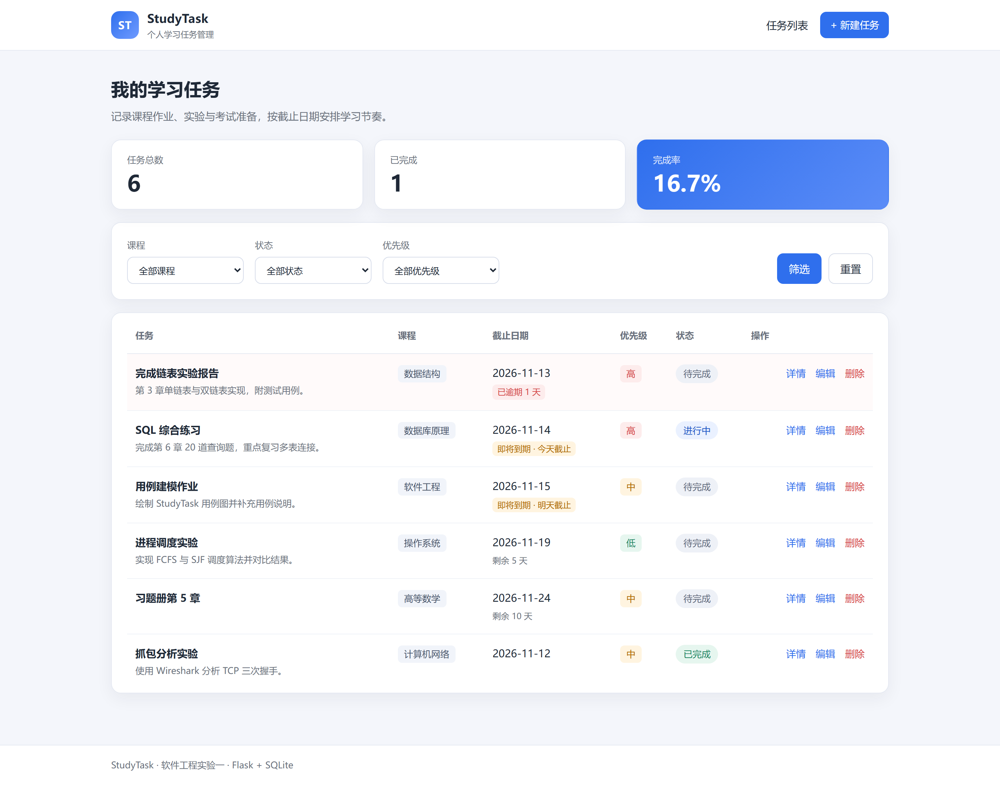
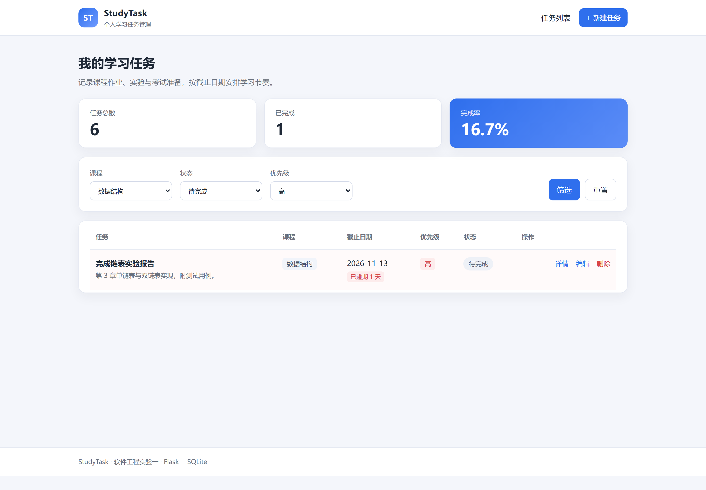
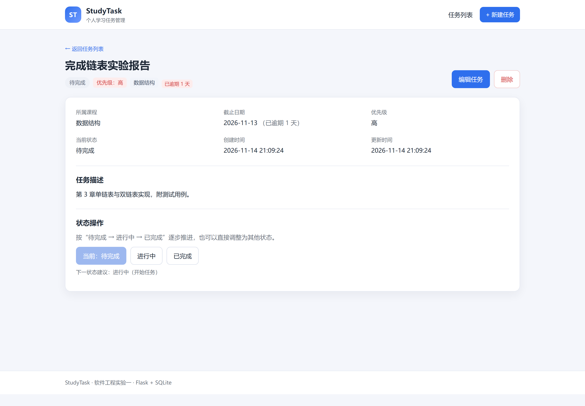
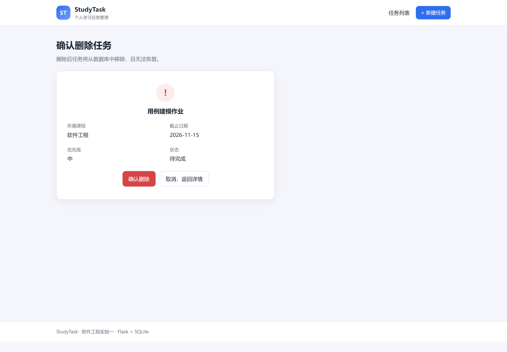
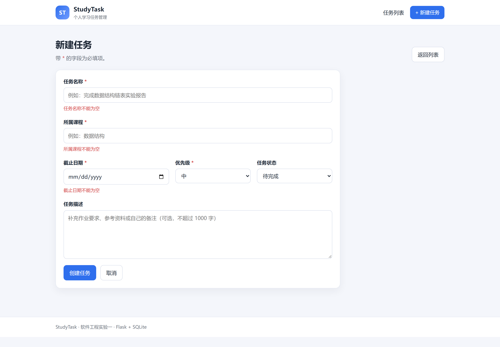
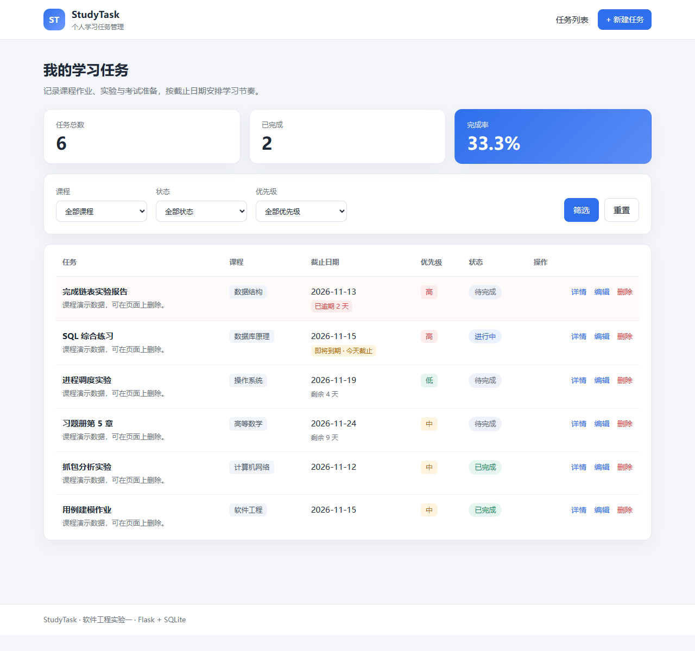

# StudyTask 需求验收表

## 1. 测试环境

| 项目 | 内容 |
| --- | --- |
| 操作系统 | Windows |
| Python | 3.13.2 |
| Flask | 3.1.2 |
| 数据库 | SQLite |
| 测试方式 | pytest 自动化测试 56 条 + 本地页面复核 |
| 测试日期 | 2026-11-15 |
| 测试结果 | 56 条全部通过，0 failed，0 error |
| 测试输出 | `docs/evidence/pytest_output.txt` |

## 2. T1—T10 验收记录

| 用例ID | 需求编号 | 输入与测试步骤 | 预期 | 实际/截图 | 通过? |
| --- | --- | --- | --- | --- | --- |
| T1 | FR-01 | 新建任务：课程“数据结构”、明天截止、高优先级，提交表单 | 列表显示新增任务，字段正确保存 | 提交后跳转详情页，列表和详情字段一致，数据库记录正确；截图 `evidence/01_task_list.png` | 是 |
| T2 | FR-01 | 名称为空，提交新建表单 | 提示错误，不产生脏数据 | 返回 400，提示“任务名称不能为空”，任务数保持 0；截图 `evidence/05_validation_error.png` | 是 |
| T3 | FR-03 | 打开任务详情，修改描述和优先级后提交 | 修改成功，刷新后仍保留 | 提交后回详情页，新描述和高优先级显示正确，刷新后仍保留；截图 `evidence/03_task_detail.png` | 是 |
| T4 | FR-05 | 在详情页依次点击“进行中”“已完成” | 状态逐次更新并持久保存 | 两次提交均成功，详情页和数据库依次显示进行中、已完成；截图 `evidence/03_task_detail.png` | 是 |
| T5 | FR-06 | 分别按课程、状态、优先级筛选，再测试三项组合 | 只显示匹配任务，组合条件准确 | 单独筛选和组合筛选均只显示匹配项，无匹配时显示空状态；截图 `evidence/02_filter_result.png` | 是 |
| T6 | FR-07 | 新建昨日到期且未完成的任务，打开列表和详情 | 显示逾期标识 | 列表和详情显示“已逾期 1 天”，已完成任务不显示逾期；截图 `evidence/03_task_detail.png` | 是 |
| T7 | FR-07 | 新建明日到期且未完成的任务，并测试今天、3 天后、4 天后 | 今天起 3 天内显示即将到期，4 天后不显示 | 今天、明日、3 天后均显示“即将到期”，4 天后不显示；截图 `evidence/03_task_detail.png` | 是 |
| T8 | FR-08 | 创建 5 项任务，将其中 2 项标记为已完成 | 总数 5、完成数 2、完成率 40% | 首页显示 5、2、40%；空库显示 0%；截图 `evidence/01_task_list.png` | 是 |
| T9 | FR-04 | 打开删除确认页，先取消，再确认删除 | 取消不删除；确认后从数据库删除 | 取消后任务仍在；确认后数据库无记录，详情返回 404；截图 `evidence/04_delete_confirm.png` | 是 |
| T10 | FR-09 | 关闭应用并重新启动，查询原任务 | 已保存数据仍可查询 | 重启后列表和详情仍能读取原任务及状态；测试输出 `evidence/pytest_output.txt` | 是 |

## 3. 补充校验

| 用例ID | 需求编号 | 输入与测试步骤 | 预期 | 实际/截图 | 通过? |
| --- | --- | --- | --- | --- | --- |
| T11 | FR-01 | 不填优先级和状态，直接提交 | 默认“中”“待完成” | 按默认值保存 | 是 |
| T12 | FR-01 | 标题、课程首尾输入空格 | 去除空格后保存 | 保存值已去除首尾空格 | 是 |
| T13 | FR-01 | 标题 100 字、课程 60 字、描述 1000 字 | 边界值可保存 | 均保存成功 | 是 |
| T14 | FR-01 | 空课程、空日期、非法日期 `2026-02-30` | 返回 400，不写入数据库 | 提示对应错误，任务数不变 | 是 |
| T15 | FR-01 | 标题 101 字、课程 61 字、描述 1001 字 | 返回 400，不写入数据库 | 提示长度限制，任务数不变 | 是 |
| T16 | FR-05 | 提交非法优先级或非法状态 | 返回 400，不写入数据库 | 提示枚举错误，原值不变 | 是 |
| T17 | FR-10 | 访问不存在的任务 ID、超大任务 ID | 返回 404，不出现 500 | 详情、编辑、删除均返回 404 | 是 |
| T18 | A.4 | 创建 200 条任务后打开列表 | 页面正常渲染 | 列表正常打开，筛选可用 | 是 |

## 4. 缺陷记录

| 编号 | 现象 | 处理 | 复测 |
| --- | --- | --- | --- |
| D4（历史缺陷） | 访问超出 SQLite INTEGER 范围的任务 ID 曾触发 `OverflowError`，返回 500 | 在 `task_service.get_task()` 中增加 `1 <= id <= 2^63-1` 范围校验，非法 ID 视为不存在 | 超大 ID 的详情、编辑、删除均返回 404，通过 |

本轮验收未发现新增严重缺陷。

## 5. 截图附录

以下截图与表中“实际/截图”列的证据链接一一对应，均可点击查看原图。

### 图 1 首页任务列表（T1、T8）

### 图 2 组合筛选结果（T5）

### 图 3 任务详情与状态（T3、T4、T6、T7）

### 图 4 删除确认页（T9）

### 图 5 输入校验（T2）

### 图 6 线上首页（部署验收）

截图说明：图 1—图 5 为本地真实运行截图，图 6 为 PythonAnywhere 线上运行截图；截图中的演示任务数据仅用于验收展示。
